# AI 自迭代的小游戏 Agent · 全文整理

> **原文**：《AI 自迭代的小游戏 Agent：2周上线6款小游戏，3天迭代12款小游戏》
> **公众号 / 署名**：大淘宝技术（署名「营销&交易技术」）｜**作者**：辰霁、成禹，淘天集团业务技术-营销&交易技术团队
> **发布时间**：2026-09-23 14:34（浙江）
> **原文链接**：https://mp.weixin.qq.com/s/jWpz6woP95eowKaFYVUSpg
> **整理日期**：2026-11-22
> **原文规模**：正文约 1.1 万字，**60 张配图**（含大量表格内截图），本整理已全部归档至 `assets/`

---

## 0. 阅读地图

**一句话主旨**：把分散在小游戏各环节的单点 AI 能力串成一条「创意进 → 游戏出 → 数据回流 → 方案再迭代」的全链路自迭代系统，用**上下文流转**解决生产侧协同、用**决策闭环**解决运营侧归因，让 AI 在边界内闭环、人只做两件事。

**人的两项职责**：① 定义北极星指标与行动边界；② 审核关键方案。
**AI 负责**：策略、开发、数据归因。

| 环节 | 回答的问题 | 对应章节 |
| --- | --- | --- |
| 问题定义 | 单点提效为什么带不动整体提速？生产/运营各自卡在哪？ | 1 |
| 顶层设计 | 全链路 L1–L5 怎么分层？为什么不做「超级 Agent」？ | 2 |
| 生产 Agent | 6 个专业 Agent 怎么把创意变成可上线代码？ | 3 |
| 运营 Agent | 数据怎么变成决策、决策怎么被验证、经验怎么沉淀？ | 4 |
| 边界与展望 | 现在受什么限制？下一步扩展到哪里？ | 5 |

**⚠️ 先看清数据口径**（本文有多组统计范围，详见附录 B，不可相加或互证）：

| 来源 | 数字 |
| --- | --- |
| 图 3「阶段业务结果总览」（2026 年 8 月） | 单月上新 **5 种游戏类型 / 9 款新游戏**；单月迭代 **12 款**线上游戏、完成 **20+ 次**迭代 |
| 正文「生产 Agent 验证」（7 月起） | **2 周上线 6 款**；平台内最快约 **1 小时**走完生产流程；含测试验收到正式上线最快 **2 天** |
| 正文「运营 Agent 验证」（8 月底起） | 共上线 **20+ 次**迭代和 **1 款**新游戏；首周对 **12 款**小游戏全面迭代，**95%+** 迭代正向、**40%+** 全指标正向，方案产出到上线只用 **3 天** |
| 标题 | 2 周上线 6 款小游戏、3 天迭代 12 款小游戏 |

---

## 1. 引言与问题定义

### 1.1 背景：环节都变快了，整体流程没有同比提速

过去一年，AI Coding、生图、数据分析和 Agent 快速进入软件研发各环节。**今年 1 月**，团队已跑通「AI Coding + 生图 + 关卡生成」一套可复用的小游戏 AI 协同流程和技术基础能力。但遗留一个核心问题：**每个环节都在变快，完整的业务流程却没有同比提速**。

由此引出两个追问：

1. 如果 AI 已能理解策划、生成美术、修改代码、读取数据并执行实验，游戏生命周期中**还有多少工作需要人持续推动**？
2. AI 能否不只完成某个环节，而是**参与一款游戏从生产、上线到持续迭代的全过程**？

系统覆盖的全链路：**选型 → 策划 → 美术 → 音频 → 开发 → 关卡生产 → 发布 → AB 实验 → 效果归因 → 再次迭代**。

### 1.2 为什么要做一套自迭代的 Agent

**生产侧：单点提效无法支持游戏快速上线**

- 即使 AI Coding、生图、关卡生成单点效率明显提升，上线一款新小游戏**仍需 2～3 周**，因为每个环节都需要人工反复确认。
- **从创意到原型最快也要 6 天**，而小游戏研发周期重度依赖原型。
- **能力孤岛**：策划、美术、代码、关卡各环节的 AI 工具零散割裂。

**运营侧：纯人工无法高效同时运营多个游戏**

| 问题 | 表现 |
| --- | --- |
| 经验难以复用 | 不同运营同学可能对相同数据给出完全不同的归因，经验停留在个人手里 |
| 分析不够精细 | **10+ 款**游戏 × 场域 / 游戏 / 关卡**三级数据**，且每日更新，数据量庞大 |
| 结论缺少验证 | 无论 AI 还是人都能写出论证完整的分析报告，但上线后未必对核心指标有正向收益 |
| 归因缺乏统一上下文 | 数据、代码、关卡配置、变更历史分散在不同系统，分析时很难完整追溯当时发生了什么 |

**结论**：这不是一个简单的单链路 Workflow 问题——**生产 Agent 依赖多环节上下文传递，运营 Agent 依赖持续归因**。

### 1.3 如何解决：上下文流转 + 决策闭环

**生产闭环（解决上下文流转）**

- 玩法调研、策划方案、资产清单、关卡数据结构进入**多 Agent 的全局状态**，下游 Agent 直接读取，不再重复获取或依赖人工搬运。
- 用户中途修改需求时，由 **Producer** 统一判断影响范围，并逐级路由到需要重做的下游环节。

**迭代闭环（处理数据驱动决策，七步）**

| 步骤 | 动作 |
| --- | --- |
| ① 感知状态 | 读取三级报表、AB 实验快照、变更记录和版本时间线 |
| ② 理解目标 | 对齐北极星指标与行动边界 |
| ③ 拆解决策 | 判断每日迭代优先级 |
| ④ 调用能力 | 按任务召唤专家角色，强制加载任务手册和既有知识 |
| ⑤ 产出方案 | 产出迭代提案或新游戏立项书 |
| ⑥ 读取反馈 | 读取 AB 实验回流数据，到期后对照预期收益结算 |
| ⑦ 沉淀经验 | 将归因结论写入知识库与记忆 |

**分工总纲**：人定义北极星指标和行动边界、负责审核；AI 负责策略、开发和数据归因。

---

## 2. 小游戏自迭代 Agent 全链路架构

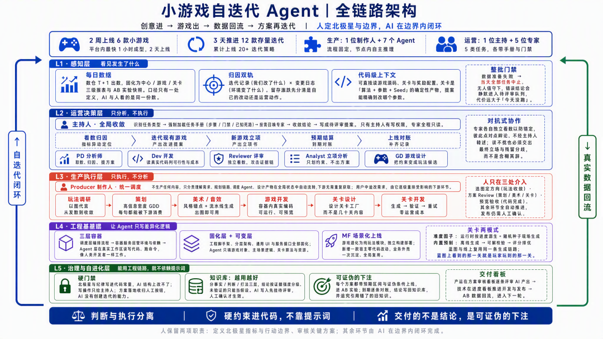

### 2.1 正文描述的 L1–L5 流转

```
L1 数据感知层 → L2 运营 Agent（判断当天最值得改哪款游戏，产出带预期的待评审方案）
→ 人工审核 → L3 生产 Agent → L4 游戏容器与模板（变成可上线代码）
→ L5 运营 Agent（设置门禁、沉淀知识、AB 实验到期回收结果）→ 回到 L1 继续下一轮
```

- **L1**：把前一天的数据、变更记录和游戏代码整理成可信上下文。
- **L2**：产出**带预期**的待评审方案（不是只有结论）。
- **L3**：接收已确认的方案，完成策划、美术、音效、代码、关卡生产。
- **L4**：游戏容器与模板承载可上线代码。
- **L5**：门禁、知识沉淀、实验结果回收（正文称「L5 运营 Agent」；架构图中该层命名为「治理与自进化层」，见附录 B）。

### 2.2 架构图补充信息（img-06，正文未逐项展开）

> 图顶部副标题：**创意进 → 游戏出 → 数据回流 → 方案再迭代 ｜ 人定北极星与边界，AI 在边界内闭环**。
> 四组概览：**2 周上线 6 款**（平台内最快 1 小时成型，2 天上线）｜**3 天推进 12 款存量迭代**（累计 20+ 次存量迭代）｜**生产：1 位制作人 + 7 个 Agent**（流程固定、节点内自主推理）｜**运营：1 位主持 + 5 位专家**（5 类任务，各带手册与门禁）。
>
> 按架构图的层次命名（与正文 L1–L5 对应关系见附录 B）：
>
> | 层 | 定位 | 主要模块 |
> | --- | --- | --- |
> | **L1 感知层**「看见发生了什么」 | 把数据变成可信上下文 | **每日数据**（数仓 T+1 出数，固化为中心 / 游戏 / 关卡三级报表与 AB 实验视图，口径只有一次定义，AI 与人看同一份数）；**归因双轨**（冻结记录「我们改了什么」× 变更日志「环境变了什么」）；**代码级上下文**（可直接读游戏源码、关卡与奖励配置、关卡库「算法 + 参数 + Seed」的确定性产物，提案能精确到改哪个参数）；**整批门禁**（数据准备失败则当天所有任务中止，宁可不跑也不让半批数据进入待评审队列） |
> | **L2 运营决策层**「只分析，不执行」 | 主持人 + 专家团 | 主持人全局收敛：看数回归 → 识别任务类型 → 强制加载任务手册（步骤 / 门禁 / 已知死路）→ 召回专家 → 收敛结论 → 写成待评审提案；**只有主持人有收敛权**。任务类型含迭代现有游戏（改进提案）、新游戏立项（立项书）、预期结算、上线对账。专家含看数归因、PD 分析师、Dev 开发（读真实代码）、Reviewer 评审（独立看数、双重证据）、Analyst 专项分析、GD 游戏设计等。**对抗式协作**：专家各自独立看数以隔离锚定，围绕方案互相论证，分歧在对话中解决 |
> | **L3 生产执行层**「只执行，不分析」 | Producer 统一调度 | 链路：玩法调研（以图收敛）→ 策划（高密度 GDD，每段可被下游直接消费）→ 美术 / 音效（风格锚点 + 流水线生成）→ 游戏开发（容器隔离真实编码，可运行可预览）→ 关卡设计（设计关卡工厂，而非做几关内容）→ 关卡开发（生成 → 验证 → 重试） |
> | **L4 工程基座**「让 Agent 只写差异化逻辑」 | 固化层 + 可变层 | 三层容器（每个 Coder 节点配一套工程环境）；工程脚手架、通用接口、服务端能力固化；**MF 模块化上线**（每个游戏作为独立子应用被宿主动态加载，独立构建、独立发布）；关卡两模式（蓝图与运行时复用同一条生成链路） |
> | **L5 治理与自进化层**「能用工程回滚，就不依赖提示词」 | 门禁 + 知识 | 硬门禁（无证据不得推进）；知识库分级（未经验证的只能做回测）；可证伪的下注（方案写预测区间与证伪条件，AB 到期对照并回看引用的旧知识）；交付与看板（方案审核 → 数据看板 → 进度看板 → AB 回流 → 下一轮） |
>
> 图右侧：**人只在三处介入**（方向选择 / 方案审核 / 质量验收），其余全部自动推进，发布仍需人工确认。
> 图底部三条原则：**判断与执行分离 ｜ 硬约束进代码，不靠提示词 ｜ 交付的不是结论，是可证伪的下注**。
> 图最底一行：人保留两项职责（定义北极星指标与行动边界、审核关键方案），其余环节由 AI 在边界内闭环完成。

### 2.3 不做「超级 Agent」：判断与执行分离

| Agent | 输入 | 职责 | 沉淀 |
| --- | --- | --- | --- |
| **生产 Agent** | 已确认的方案 | 策划、美术、音效、代码、关卡生产 | 游戏架构、资产规范、开发经验 |
| **运营 Agent** | 业务报表、AB 实验、变更记录、历史记忆 | 问题归因、优先级判断、决定应该改什么 | 业务指标、实验结果、决策依据 |

职责清晰、**相互隔离但可以互相查阅上下文**。

---

## 3. 小游戏生产 Agent

### 3.1 规模化生产：两周上线 6 款小游戏

从 **7 月**开始，用两周时间通过这套 Agent 完成并发布 **6 款小游戏**（原文表格列出：忍者跳跃、盖楼小游戏、飞机大战、贪吃蛇大作战、打地鼠、祖玛，每款附平台截图）。

- 最快的一款在 Agent 平台内走完整生产流程**约 1 小时**；算上测试、验收和上线流程，从创意到正式上线**仅用 2 天**。
- **生产关系变化**：参与生产的不限于开发同学，测试、PD、运营也能用自己的 idea 制作小游戏，从需求提出者、协作者转变为**直接的生产者**。

### 3.2 系统架构：Producer 统一调度 Multi-Agent

**两大技术栈**：

| 技术栈 | 职责 |
| --- | --- |
| **LangGraph** | 全局流程编排与多 Agent 协调 |
| **Claude Agent SDK（tarot-code-agent）** | 在远程容器中执行真实的代码生成 |

以 **Producer（制作人）** 为核心调度节点，协调 6 个专业 Agent，生产链路：

```
Gameplay Research → Planner → Art Designer → Game Coder → Level Designer → Level Coder
```

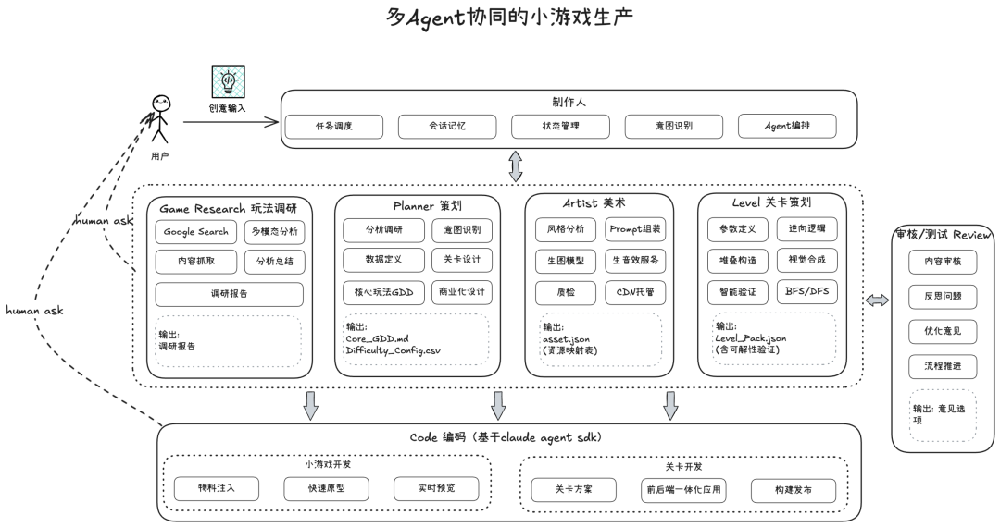

> 架构图转录（img-14）：
> - **制作人**：任务调度、会话记忆、状态管理、意图识别、Agent 编排。
> - **Game Research 玩法调研**：Google Search、多模态分析、内容抓取、分析总结 → 输出**调研报告**。
> - **Planner 策划**：分析调研、意图识别、数据定义、关卡设计、核心玩法 GDD、商业化设计 → 输出 `Core_GDD.md`、`Difficulty_Config.csv`。
> - **Artist 美术**：风格分析、Prompt 组装、生图模型、生音效服务、质检、CDN 托管 → 输出 `asset.json`（资源映射表）。
> - **Level 关卡策划**：参数定义、逆向逻辑、难题构造、视觉合成、智能验证、BFS/DFS → 输出 `Level_Pack.json`（含可解性验证）。
> - **审核 / 测试 Review**（右侧）：内容审核、反思问题、优化意见、流程推进；用户可通过 `human ask` 介入各 Agent。
> - **Code 编码（基于 claude agent sdk）**：小游戏开发（物料注入、快速原型、实时预览）+ 关卡开发（关卡方案、前后端一体化应用、构建发布）。

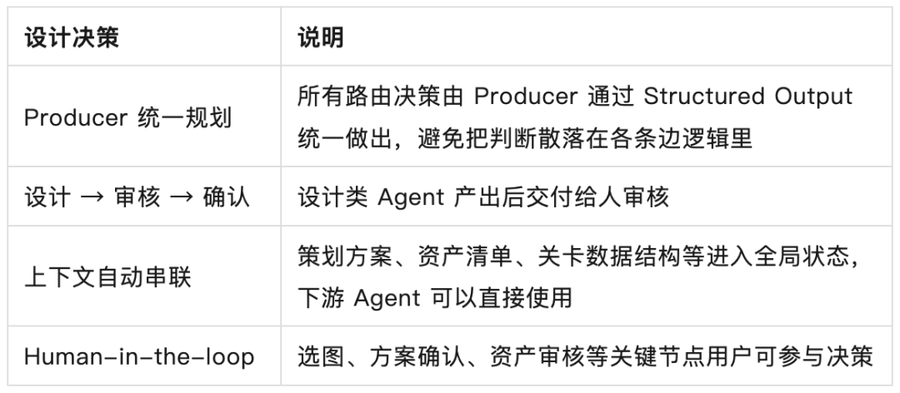

| 设计决策 | 说明 |
| --- | --- |
| **Producer 统一规划** | 所有路由决策由 Producer 通过 **Structured Output** 统一做出，避免把判断散落在各条边逻辑里 |
| **设计 → 审核 → 确认** | 设计类 Agent 产出后交付给人审核 |
| **上下文自动串联** | 策划方案、资产清单、关卡数据结构等进入全局状态，下游 Agent 可以直接使用 |
| **Human-in-the-loop** | 选图、方案确认、资产审核等关键节点用户可参与决策 |

### 3.3 六个专业 Agent 详解

#### ① Producer（制作人）— 全局调度中枢

不直接生产任何内容，只专注**理解需求、规划链路、调度 Agent**；分析当前项目状态后按阶段推进，用户中途介入修改时**动态调整后续计划**。示例：用户说「新增一种敌机」→ 先调度策划 Agent 更新资产清单 → 再调度资产 Agent 生成美术资产 → 最后调度开发 Agent 执行代码开发。

#### ② Gameplay Research（玩法调研）— 从创意到调研报告

一个创意往往模糊（「做一个倒水小游戏」可能对应写实物理模拟、卡通益智闯关、解压 ASMR 等截然不同的类型），核心任务是**帮用户从发散收敛到明确的玩法方向**：

- **从发散到收敛**：不要求用户用文字精确描述，而是**让用户从真实游戏截图中选择**（先搜索、后选图）。
- **游戏规则提炼**：直接让 LLM 分析选中的截图，从视觉中提取核心玩法机制，作为内容搜索关键词，精准定位详细玩法规则与通关攻略。
- **筛选美术资产模板**：从选中图片中筛出最适合的 **2–3 张**参考图，贯穿到后续 Art Designer 生成流程。

原文附「小游戏 / 玩法调研」示例表：飞机大战、忍者跳跃、麻将消消乐（各附调研截图）。

#### ③ Planner（策划 Agent）— 策划方案生成

把调研结果转化为**信息密度高、可直接使用的游戏设计文档（GDD）**：

- **信息密度优先**：每一段描述都必须能被下游 Agent 直接消费——游戏实体和操作规则给 Game Coder 实现玩法、资产清单给 Art Designer 生图、关卡设计给 Level Designer 定配置结构。如果一段描述不能映射到具体开发动作，就不写。
- **两类资产需求**：**程序资产**（游戏实体、动画状态机、粒子特效等需代码实现的对象）；**素材资产**（角色立绘、背景、UI 图标、音频等需生成的素材）。
- **定义美术风格**：先确定整体风格、主色调、参考方向（「扁平卡通」「像素复古」「3D 写实」），作为生图的全局约束，避免风格不统一、后期返工。

#### ④ Art & Audio Designer（资产 Agent）— AI 生图、生音频

执行类 Agent，**直接输出文件，不再多写一层方案**。

**美术资产最难的不是「能不能生成图片」，而是生成结果能否稳定进入工程**，因此用了几层约束：

| 约束 | 内容 |
| --- | --- |
| 三层风格锚点 | **基准风格 Base**（调研阶段推荐的风格参考图）；**整体风格 Style**（首张生成素材作为锚点，后续资产以此为参考）；**代表图 Entity**（有多种状态/关系的游戏对象，用标准态作参考图） |
| 页面框架图 & 布局分析 | 所有元素完成后合成页面框架图，再用多模态模型分析游戏区布局、输出结构化描述，让 Game Coder 读到布局意图，而不是拿零散图片猜位置 |
| 四种执行模式 | 首次全量生成 / 用户指定局部重生 / 续生失败资产 / 回答美术咨询；由 LLM 做意图分类，局部修改不必从头生成 |

美术资产流程表（原文）：**资产规划**（LLM 依据 GDD 列出完整资产，含朝向图、拆分图，先规划再生图）→ **美术资产生成**（两类锚点保证风格一致）→ **美术资产矫正**（用工程能力处理 AI 生图无法精准对齐的问题）。原文附「游戏 / 美术资产」示例表：水果忍者、祖玛、流沙方块。

**音频资产设计**：音效 Agent 采用 **ReAct 模式**，LLM 分析 GDD 后自主决定生成哪些音效；按 **BGM / 交互音效 / 状态音效 / UI 音效**分类输出，Game Coder 可直接按场景引用。关键优势段补充：生图走 **Gemini 生图 + 抠图**，音效通过 Tool Use 逐个调用**可灵 AI** 生成。

#### ⑤ Level Designer（关卡设计 Agent）— 设计关卡工厂而非关卡

不逐一设计每一关，而是**定义数据结构、生成算法、验证策略和难度曲线**。核心是让每一关成为**确定性产物**：

```
算法 + 参数 + Seed  →  每一关（AI 看得懂、改得动、改完可验证）
```

关卡方案严格限定为 **5 章**：`gameType`、数据结构、生产方式、验证方式、难度曲线；每章都是 Level Coder 的直接输入，且优先基于 Game Coder 已实现的 TypeScript 接口设计，确保产出即可落地。

**关卡生成模式**按两个判断选择：① 关卡生成后是否必然有解？② 生成 & 可解性判定是否耗时？

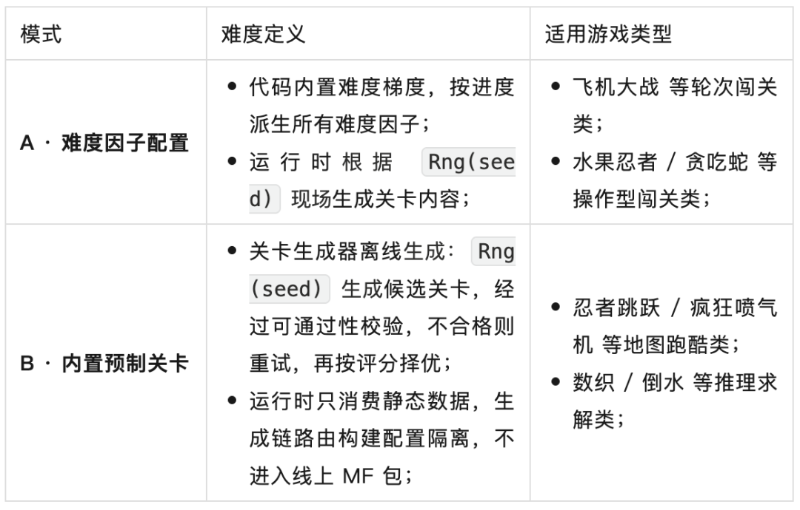

| 模式 | 难度定义 | 适用游戏类型 |
| --- | --- | --- |
| **A · 难度因子配置** | 代码内置难度梯度，按进度派生所有难度因子；运行时根据 `Rng(seed)` 现场生成关卡内容 | 飞机大战等轮次闯关类；水果忍者 / 贪吃蛇等操作型闯关类 |
| **B · 内置预制关卡** | 关卡生成器离线生成：`Rng(seed)` 生成候选关卡，经过可通过性校验，不合格则重试，再按评分择优；运行时只消费静态数据，生成链路由构建配置隔离，不进入线上 MF 包 | 忍者跳跃 / 疯狂喷气机等地图跑酷类；数织 / 倒水等推理求解类 |

两种模式共同遵守一条 **MF 契约**：宿主默认只下发**当前关卡数 & 总关卡数**，游戏依据通关进度在本地动态生成关卡，或直接使用内置关卡。

**关卡迭代自闭环**（确定性生成带来的三项能力）：

- **可溯源**：任意一天、任意一关都能还原生成过程，问题关卡可通过 Seed 和难度因子精确复现。
- **可改造**：LLM 分析层拿到真实生成代码（不只是配置值），提案可明确到参数及目标值；执行层修改源码后，可通过蓝图可视化和 Seed 逐关 diff 回归。
- **可验收**：蓝图与运行时复用同一条生成链路，**蓝图中看到的关卡就是玩家实际进入的关卡**。

#### ⑥ Game Coder & Level Coder — 远程容器编码

链路中**唯一需要真实开发环境**的 Agent：不只输出代码文本，还要读写文件、安装依赖、启动开发服务器。

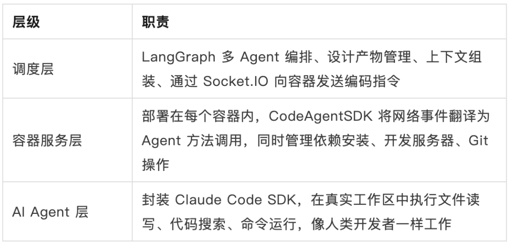

| 层级 | 职责 |
| --- | --- |
| **调度层** | LangGraph 多 Agent 编排、设计产物管理、上下文组装、通过 **Socket.IO** 向容器发送编码指令 |
| **容器服务层** | 部署在每个容器内，**CodeAgentSDK** 将网络事件翻译为 Agent 方法调用，同时管理依赖安装、开发服务器、Git 操作 |
| **AI Agent 层** | 封装 **Claude Code SDK**，在真实工作区中执行文件读写、代码搜索、命令运行，像人类开发者一样工作 |

### 3.4 MF 场景化：模块联邦，动态可插拔

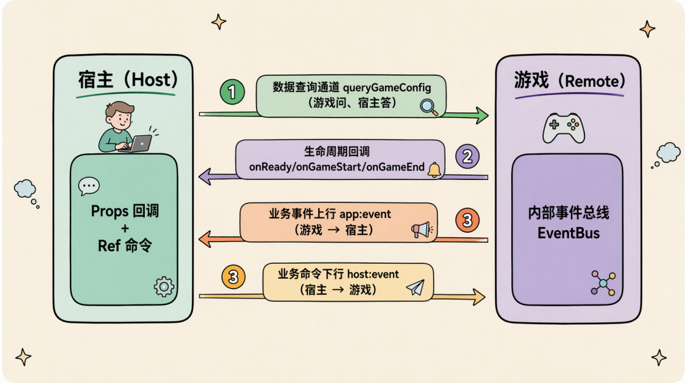

宿主（Host）持有 **Props 回调 + Ref 命令**，游戏（Remote）持有**内部事件总线 EventBus**，协议三部分：

| # | 通道 | 方向 | 说明 |
| --- | --- | --- | --- |
| ① | **统一数据查询通道 `queryGameConfig`** | 游戏问、宿主答 | 不为每种数据设计一个接口，而是用一个**通用异步函数**承载所有数据请求；宿主侧自由决定数据来源，游戏侧只负责消费 |
| ② | **标准生命周期回调** | 游戏 → 宿主（单向通知） | 模板统一封装 `onReady` / `onGameStart` / `onGameEnd`，游戏在关键节点通知宿主 |
| ③ | **双向事件协议** | 上行 + 下行 | `app:event`（游戏 → 宿主）：`emit('app:event', name, payload)` 发出，宿主 `onEvent(name, payload)` 接收；`host:event`（宿主 → 游戏）：`ref.sendHostEvent(name, payload)` 发出，游戏 `on('host:event', handler)` 接收。所有额外业务事件都走这两条固定通道 |

**固化层 + 可变层**（预置在壳应用中，让 Coder 只关注差异化逻辑）：

| 壳应用 | 固化层 | 可变层 |
| --- | --- | --- |
| **小游戏壳应用** | Phaser + React 工程脚手架、Controller 分层架构（业务/游戏/音频）、通用 UI 框架（Loading/导航栏/功能面板）、状态管理机制、通用接口设计（关卡查询推进、道具 CRUD）、资源加载链路、事件总线 | 游戏对象和管理器、主场景逻辑、具体 UI 内容与交互、关卡配置数据、道具效果、资源定义 |
| **关卡生成壳应用** | Period → Day → Level 三级周期配置、通用服务接口（关卡/道具/广告链路）、前端路由框架和 gameType 注册机制、Schema 驱动的配置体系、构建发布流程 | 具体游戏的关卡生成算法、验证逻辑、可视化页面、关卡 JSON 结构、参数曲线 |

两个好处：Coder 不用从零搭建工程基础设施；服务端能力完全复用（关卡查询、关卡推进、道具管理、广告打通等接口新游戏无需重复开发）。

### 3.5 画布视图 & 经典视图：两种交互形态

多 Agent 生产会话里同时存在调研报告、策划方案、美术资产、音频资产、关卡方案和游戏容器，单一交互方式难以兼顾纵深操作与全局审查，因此提供两种视图并允许随时切换：

| 维度 | 经典视图 | 画布视图 |
| --- | --- | --- |
| 交互设计 | 对话 + 产物面板（Copilot 范式） | 节点 + 连线（Workflow 范式） |
| 信息组织 | 线性编排，聚焦单一环节 | 空间并列，展示全局拓扑 |
| 使用场景 | 首次生产、单环节审阅 | 全局审查、迭代修改、精细调整 |

（原文另附「页面视觉」两列截图，分别对应两种视图的界面。）

### 3.6 关键优势与核心特点

**架构层面：Workflow 与自主推理的融合**

纯 Workflow 每步固定、灵活性差；纯自主 Agent 全靠模型决策、不可控且 token 消耗大。LangGraph + Claude Agent SDK 的组合取两者平衡：

- **LangGraph 提供「可控的流程骨架」**：主干确定（调研→策划→美术→编码→关卡→关卡编码），阶段间流转、审核、暂停恢复由结构硬性保证，不依赖模型判断；即使模型偶尔跑偏，整体流程也不失控。
- **子 Agent 内部充分发挥自主推理**：Planner 自主决定 GDD 章节深度、Art Designer 自主分析依赖关系与生成顺序、Level Designer 自主判断是否需要提问；流程不干涉节点内部推理。
- **两个引擎各取所长**：设计类 Agent 直接调 LLM API（响应快、成本低）；Coder 类 Agent 通过 Claude Agent SDK 在隔离容器中执行，拥有完整文件系统与工具链；设计产物通过全局状态自动流入 Coder 的系统提示词，无需额外「交接」。
- **Human-in-the-loop 时机精心设计**：只在三类关键节点暂停，其余全自动——**方向选择**（调研阶段选图）、**方案确认**（策划/关卡/美术产出后 Review）、**质量验收**（代码完成后预览）。

**子 Agent 层面的针对性设计**：玩法调研「以图代言」、策划方案「信息密度最大化」、美术资产「生产线式生图 Workflow」、关卡设计「信息密度与可执行性并重」。

**工程基建**：三层容器架构 + 固化框架与可变内容。

---

## 4. 小游戏运营：从数据到决策，再到自进化

### 4.1 规模化验证：12 款游戏、20+ 迭代

**8 月底** Agent 自运营能力上线后，共上线 **20+ 次游戏迭代和 1 款新游戏**。首周先对线上 **12 款**小游戏做全面迭代：

- **95%+** 的迭代呈正向效果，**40%+** 的迭代为全指标正向；
- 因分析和开发侧都已打通自动化流程，这 12 款游戏迭代**从方案产出到开发上线只用 3 天**。

原文附「小游戏 / 迭代方案 / 迭代效果」示例表：趣味数独、忍者跳跃、一箭又一箭（均标注「所有指标均正向」，各附方案与效果截图）。

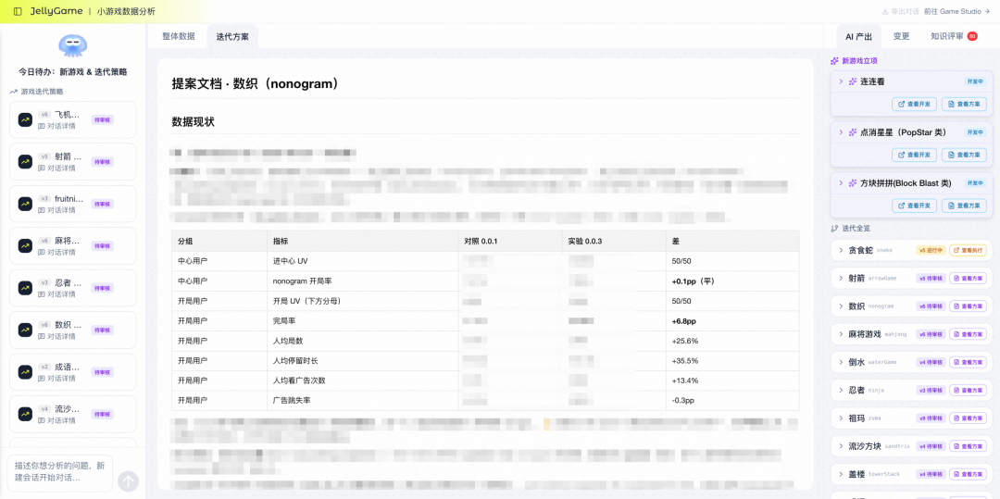

> 界面信息：平台名「JellyGame 小游戏数据分析」，含「整体数据 / 迭代方案」页签与「AI 产出 / 变更 / 知识评审」入口；提案文档按游戏组织（示例「数织 nonogram」），「数据现状」表按**中心用户 / 开局用户**分组，指标含进中心 UV、开局率、开局 UV（下方分母）、完局率、人均局数、人均停留时长、人均广告次数、广告损失率等，按**对照 / 实验 / 差**三列对比；左侧为「今日待办：新游戏 & 迭代策略」对话列表，右侧为「新游戏立项」与「迭代全览」游戏清单。具体数值多已打码，本整理不转录未公开数字。

### 4.2 Agent Team：主持人 + 专家团的对抗模式

**为什么不用单 Agent**：运营分析没有标准答案，单 Agent 容易把方案做得过于简单、把原因归到无法行动的客观因素上，或给出缺少证据、无法落地的结论。

**机制**：每个专家先**独立看数**，形成自己的上下文和证据链，避免过早锚定；不同任务有各自的系统 Prompt，明确步骤、门禁和已知死路，并在开工时强制注入；专家围绕具体方案互相论证，分歧在对话中解决，最后由主持人收敛，**不把未经处理的争论直接抛给用户**。

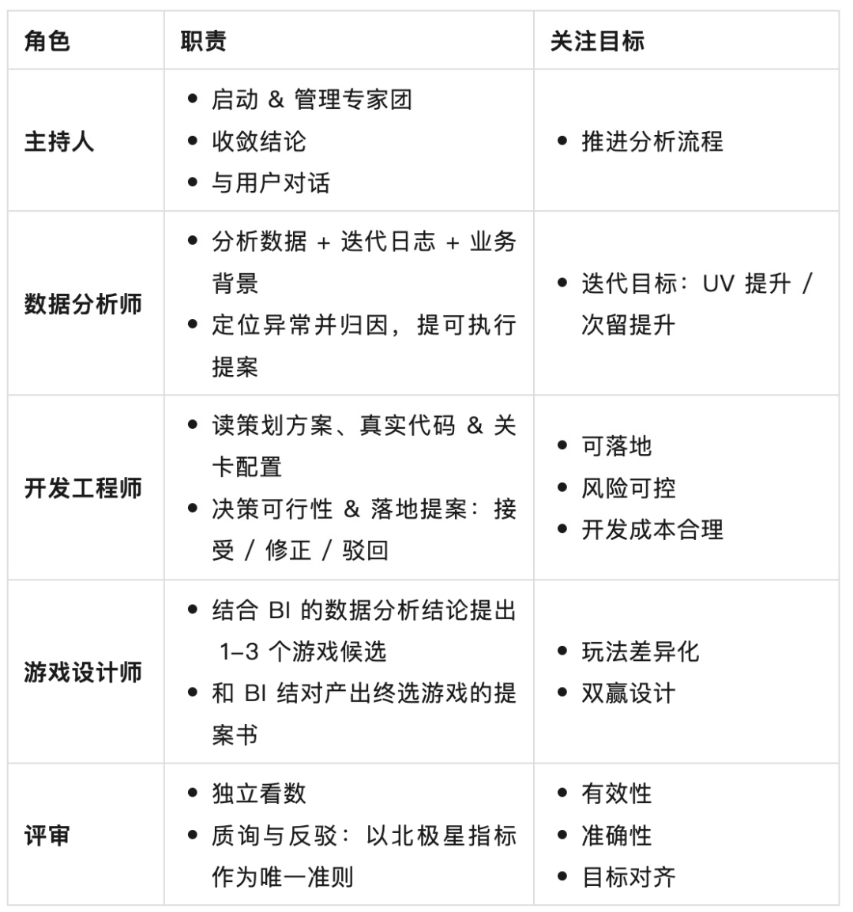

| 角色 | 职责 | 关注目标 |
| --- | --- | --- |
| **主持人** | 启动 & 管理专家团；收敛结论；与用户对话 | 推进分析流程 |
| **数据分析师** | 分析数据 + 迭代日志 + 业务背景；定位异常并归因，提可执行提案 | 迭代目标：UV 提升 / 次留提升 |
| **开发工程师** | 读策划方案、真实代码 & 关卡配置；决策可行性 & 落地提案：接受 / 修正 / 驳回 | 可落地、风险可控、开发成本合理 |
| **游戏设计师** | 结合 BI 的数据分析结论提出 **1–3 个**游戏候选；和 BI 结对产出终选游戏的提案书 | 玩法差异化、双赢设计 |
| **评审** | 独立看数；质询与反驳：以北极星指标作为唯一准则 | 有效性、准确性、目标对齐 |

**主要产出两类结果**：现有游戏**迭代提案**、新游戏**立项书**（原文各附界面截图）。

### 4.3 每日定时任务：让分析系统自己跑起来

对话式 Agent「问什么答什么」，但运营日常不应与 AI 过多实时对话，而应以**决策者身份判断结论**：前一天数据有什么变化、哪些实验预期已到期、今天最值得改哪款游戏。流程固定后编排成自动任务。

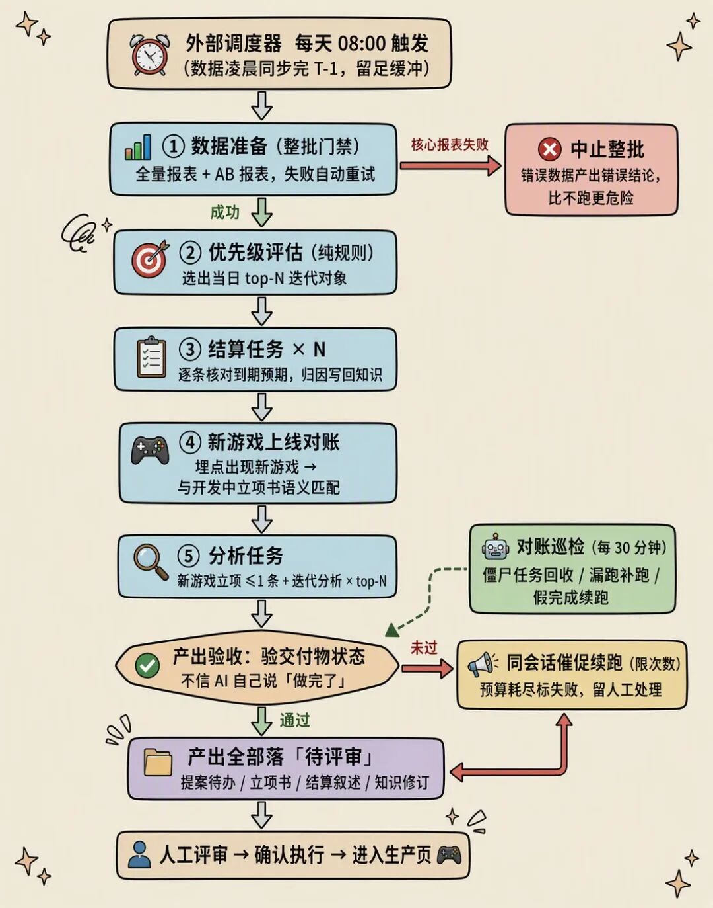

> 流程图转录（img-55）：**外部调度器每天 08:00 触发**（数据凌晨同步完 T-1，留足缓冲）→ ① **数据准备（整批门禁）**：全量报表 + AB 报表，失败自动重试；核心报表失败则**中止整批**（错误数据产出错误结论，比不跑更危险）→ ② **优先级评估（纯规则）**：选出当日 top-N 迭代对象 → ③ **结算任务 × N**：逐条核对到期预期，归因写回知识 → ④ **新游戏上线对账**：埋点出现新游戏 → 与开发中立项书语义匹配 → ⑤ **分析任务**：新游戏立项 ≤1 条 + 迭代分析 × top-N → **产出验收：验交付物状态**（「不信 AI 自己说做完了」）→ 通过则**产出全部落「待评审」**（提案待办 / 立项书 / 结算叙述 / 知识修订）→ **人工评审 → 确认执行 → 进入生产页**。
> 旁路两处：**对账巡检（每 30 分钟）**回收僵尸任务 / 漏跑补跑 / 假完成续跑；验收未过则**同会话催促续跑（限次数）**，预算耗尽标失败、留人工处理。

正文对应强调的**四道门禁**：

| 门禁 | 内容 |
| --- | --- |
| **数据整批验收** | 核心报表构建失败，当天所有任务中止；宁可不跑，也不让错误数据生成结论 |
| **验收真实状态** | 会话正常退出不代表任务完成；系统检查立项书是否新建、提案是否更新、待结算清单是否清空。未通过时在同一会话中催促续跑，预算耗尽后才标记失败并交给人工 |
| **自动巡检** | 每半小时巡检一次，回收假死任务、补跑漏掉的批次，纠正「看起来完成、实际没有交付物」的状态 |
| **统一交付标准** | 自动化只省掉中途等待同意的步骤；查重、读代码和证据要求与交互式流程一致，产物进入待评审队列，**评审权仍在人手里** |

### 4.4 能力自进化：预期收益 → 真实数据回收

**核心认知**：如果系统持续生成方案，它**不会因为跑得更多就自动变好**。因此把 Agent 的交付物重新定义为一次**可证伪的「下注」**：每个策略都要写明**预测区间、引用了哪些知识、什么结果会证伪当前判断**。数据回收时逐条对账预期与实际结果，并追溯本次判断引用的知识；如果知识本身有问题，就进入后续治理，而不是只把实验标记为成功或失败。

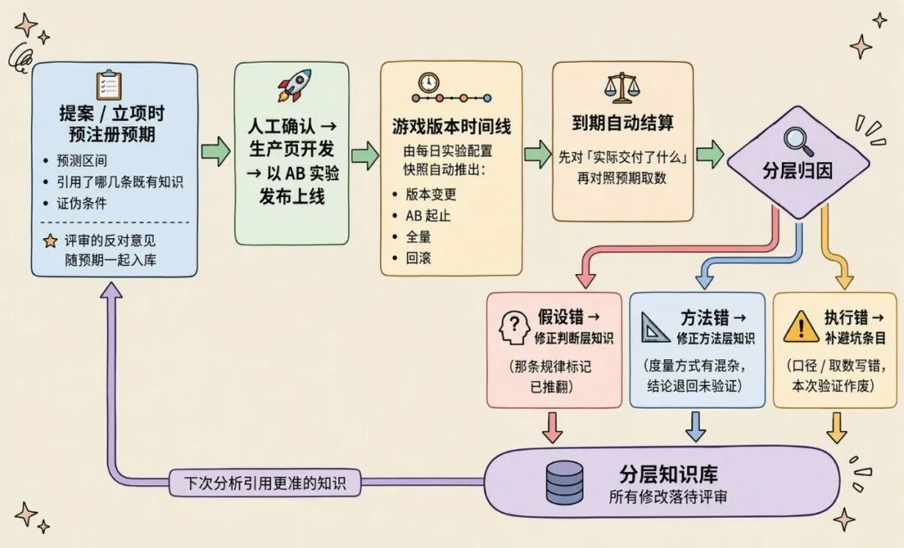

> 流程图转录（img-56）：
> **提案 / 立项时预注册预期**（预测区间、引用了哪几条既有知识、证伪条件；评审的反对意见随预期一起入库）→ **人工确认 → 生产页开发 → 以 AB 实验发布上线** → **游戏版本时间线**（由每日实验配置快照自动推出：版本变更、AB 起止、全量、回滚）→ **到期自动结算**（先对「实际交付了什么」，再对照预期取数）→ **分层归因**分三类错误：
> - **假设错 → 修正判断层知识**（那条规律标记已推翻）
> - **方法错 → 修正方法层知识**（度量方式有混杂，结论退回未验证）
> - **执行错 → 补避坑条目**（口径 / 取数写错，本次验证作废）
>
> 三类修改统一进入**分层知识库（所有修改落待评审）**，再回到「下次分析引用更准的知识」，形成闭环。

### 4.5 记忆系统：分层保存约束、经验、流程和事件

实验回收的经验需要合理保存，也要在合适的任务里取出来。系统采用**四层记忆**，把不同性质的信息放进不同成本、容量和检索方式的容器。

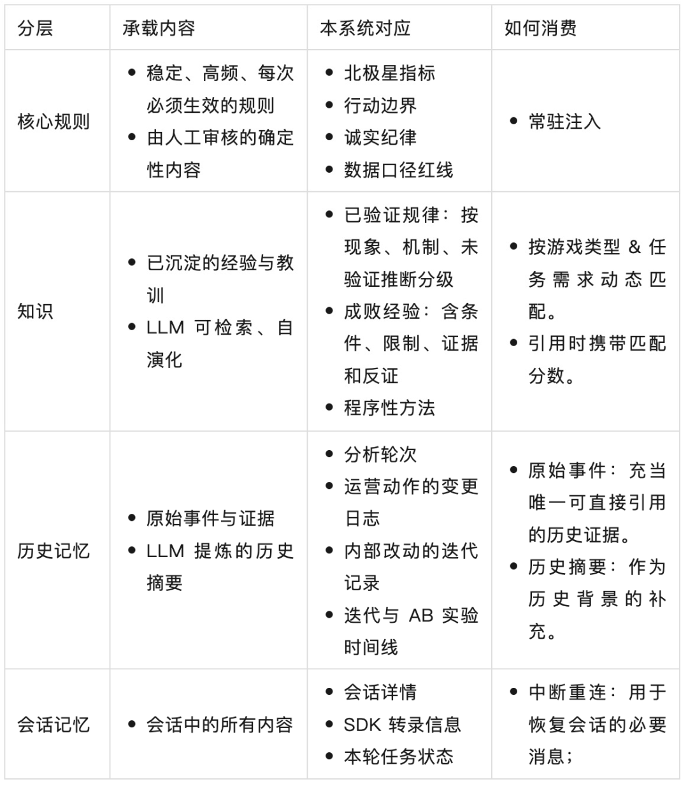

| 分层 | 承载内容 | 本系统对应 | 如何消费 |
| --- | --- | --- | --- |
| **核心规则** | 稳定、高频、每次必须生效的规则；由人工审核的确定性内容 | 北极星指标、行动边界、诚实纪律、数据口径红线 | 常驻注入 |
| **知识** | 已沉淀的经验与教训；LLM 可检索、自演化 | 已验证规律（按现象、机制、未验证推断分级）；成败经验（含条件、限制、证据和反证）；程序性方法 | 按游戏类型 & 任务需求动态匹配；引用时携带匹配分数 |
| **历史记忆** | 原始事件与证据；LLM 提炼的历史摘要 | 分析轮次、运营动作的变更日志、内部改动的迭代记录、迭代与 AB 实验时间线 | 原始事件充当唯一可直接引用的历史证据；历史摘要作为历史背景的补充 |
| **会话记忆** | 会话中的所有内容 | 会话详情、SDK 转录信息、本轮任务状态 | 中断重连时用于恢复会话的必要消息 |

**一条记忆的正文只保留「结论 + 判断依据」**，不保存一次性细节和容易过期的时效数值。每条记忆还带有**治理元数据**：

| 元数据 | 说明 |
| --- | --- |
| 作用域 | 适用于单款游戏，还是可以跨游戏复用 |
| 来源证据 | 来自哪次结算、哪个会话 |
| 证据等级 | 现象、机制或未验证推断；**低等级内容禁止使用「显著」「必然」等强断言** |
| 置信度与状态 | 候选、生效或已失效 |
| 版本链 | 可回溯到生成这条记忆时的系统状态 |

---

## 5. 总结与展望

**当前成果**：过去几个月在淘天互动业务中跑通了小游戏从选型、生产到上线迭代的完整链路。

**当前限制**：系统受**游戏模式和关卡类型**限制，优化主要以小游戏主体为主。

**下一步**：把生产与迭代扩展到**更广义的互动玩法**——围绕业务目标和用户关系，组合**抽奖、社交裂变、组队 PK、任务协作**等机制，生成相应的规则、内容与体验，并根据用户反馈持续调整和验证。

**评价标准**：最终要看玩家是否愿意参与、是否觉得好玩、是否愿意再来，以及能否带来业务增量。目标是把**一次性交付的互动项目**，变成**可持续探索玩法、理解用户并优化效果的互动服务**。

---

## 6. 团队介绍

- **作者**：辰霁、成禹，淘天集团业务技术-营销&交易技术团队。
- **团队职责**：承担淘宝天猫电商全链路交易与营销技术攻坚，推动 AI 技术能力与电商业务实践深度融合。
- **AI 能力建设**：围绕互动玩法 & 体验，覆盖多 Agent 编排、上下文流转、全链路自迭代、数据决策闭环、记忆系统等链路，把玩法创意、内容生产、研发交付和运营迭代连接起来。
- **业务落地**：覆盖淘宝秒杀、淘宝特价版 App，主导 618、双 11 等大促场景多个高价值项目，将 AI 能力规模化渗透至秒杀、导购、交易、搜索、用增等核心场景。
- **协同创新**：小游戏 Agent 打破研发与业务角色之间的生产边界，让 PD、运营、测试等角色从需求提出者转变为直接的生产者，在提升生产效率的同时**重塑互动业务的生产关系**。
- **文末拓展阅读栏目**：3DXR 技术｜终端技术｜音视频技术｜服务端技术｜技术质量｜数据算法。

---

## 附录 A：配图索引（60 张，已全部归档至 `assets/`）

| 编号 | 位置 / 内容 | 编号 | 位置 / 内容 |
| --- | --- | --- | --- |
| 01 | 文首头图（动图） | 31 | 关卡工厂：算法 + 参数 + Seed 示意 |
| 02 | 导语装饰图 | 32 | **关卡生成模式 A/B 对照表** |
| 03 | **阶段业务结果总览（2026 年 8 月，含各项百分比）** | 33 | 关卡迭代自闭环示意 |
| 04 | 第 1 章标题装饰图 | 34 | Coder 远程容器 / 三层架构示意 |
| 05 | 第 2 章标题装饰图 | 35–36 | MF 场景化：模块联邦示意 |
| 06 | **小游戏自迭代 Agent 全链路架构（L1–L5）** | 37 | **宿主与游戏通信协议图** |
| 07 | 第 3 章标题装饰图 | 38 | 生命周期回调示意 |
| 08–13 | 6 款小游戏平台截图（忍者跳跃、盖楼、飞机大战、贪吃蛇、打地鼠、祖玛） | 39–42 | 经典视图 / 画布视图页面视觉对比截图 |
| 14 | **多 Agent 协同的小游戏生产架构** | 43 | **三层容器架构职责表** |
| 15 | **生产链路四条设计决策表** | 44 | 章节装饰图 |
| 16–17 | Producer 动态调度与「新增敌机」示例 | 45–50 | **12 款游戏迭代方案与效果截图（含 JellyGame 平台界面）** |
| 18 | 玩法调研流程示意 | 51 | **Agent Team 角色职责表** |
| 19–21 | 玩法调研示例截图（飞机大战、忍者跳跃、麻将消消乐） | 52 | 专家团对抗协作示意 |
| 22 | Planner / GDD 产出示意 | 53–54 | 两类产出：迭代提案 / 新游戏立项书截图 |
| 23–24 | 资产 Agent 与美术资产设计流程 | 55 | **每日定时任务完整流程图** |
| 25–27 | 资产规划 / 生成 / 矫正三流程截图 | 56 | **可证伪下注与分层归因闭环图** |
| 28–30 | 美术资产示例（水果忍者、祖玛、流沙方块） | 57–58 | 记忆系统示意 / **四层记忆分层表** |
| 59 | 章节装饰图 | 60 | 文末尾部图 |

原始图片 URL 与下载清单见 `assets/_图片索引.txt`。

## 附录 B：口径校注（保证准确性）

整理中发现原文存在几组**统计范围不同或命名不同**的表述，此处如实标注，不擅自合并或改写：

1. **数字口径（最易混淆）**：图 3 是「2026 年 8 月阶段业务结果总览」（单月 5 种类型 / 9 款新游戏、12 款迭代 / 20+ 次迭代）；正文 3.1 是「生产 Agent 验证」（7 月起 2 周 6 款）；正文 4.1 是「运营 Agent 验证」（8 月底起首周 12 款、共 20+ 次迭代 + 1 款新游戏）；标题取生产与运营各一个代表性数字。**四者统计范围与时间窗不同，不能相加，也不能互相验证**。本整理按来源分别列出。
2. **L5 命名**：正文 2.1 把第五层称为「**L5 运营 Agent**」（设置门禁、沉淀知识、回收结果）；架构图 img-06 把第五层称为「**治理与自进化层**」，并把「L4」标为「工程基座」而非「游戏容器与模板」。两套命名描述的是同一条链路的不同切面，本整理在 2.1 保留正文口径、2.2 保留图中口径。
3. **Agent 数量**：架构图顶部标注「生产：1 位制作人 + **7 个** Agent」「运营：1 位主持 + **5 位**专家」；正文 3.2 列出 **6 个**专业 Agent 节点（Gameplay Research → Planner → Art Designer → Game Coder → Level Designer → Level Coder，美术/音效合称资产 Agent）；图 51 角色表列 **4 类专家 + 主持人**。差异来自是否把美术与音效拆分、是否把评审/分析角色单独计数，本整理不强行统一。
4. **实验数据脱敏**：图 45–50 等平台截图中的多数指标数值已打码，本整理只描述表格结构与指标名，**不转录、不推算未公开数值**；图 3 中标注的百分比为原文公开数据，照录。
5. **图 3 效果指标**：游戏对端效果实验观测（次日主动打开 **+2.5%**、停留时长 **+23.5%**、订单 **+1.3%**、GMV **+3%**）；迭代效果实验观测（停留时长 **+15.3%**、人均局数 **+6.4%**、通关率 **+1.7%**、全通率 **+1.1%**）。原文未说明这两组与正文 95%+ / 40%+ 的换算关系，故并列呈现，不作推导。

## 附录 C：关键数字速查

| 数字 | 含义 |
| --- | --- |
| 2～3 周 / 6 天 | 改造前上线一款新小游戏所需周期 / 创意到原型最快耗时 |
| 2 周 / 6 款 / 1 小时 / 2 天 | 生产 Agent：两周上线 6 款；最快一款平台内约 1 小时走完生产流程；含测试验收到正式上线最快 2 天 |
| 12 款 / 3 天 / 20+ 次 / 1 款 | 运营 Agent：首周迭代款数、方案到上线耗时、累计迭代次数、同期新游戏数 |
| 95%+ / 40%+ | 迭代正向比例 / 全指标正向比例 |
| 10+ 款 / 三级 | 运营需同时分析的游戏数 / 场域·游戏·关卡三级数据 |
| 5 种 / 9 款 / 12 款 / 20+ 次 | 图 3：2026 年 8 月单月上新类型数、新游戏数、迭代款数、迭代次数 |
| +2.5% / +23.5% / +1.3% / +3% | 图 3 游戏对端效果：次日主动打开 / 停留时长 / 订单 / GMV |
| +15.3% / +6.4% / +1.7% / +1.1% | 图 3 迭代效果：停留时长 / 人均局数 / 通关率 / 全通率 |
| L1–L5 | 全链路五层架构 |
| 6 / 7 / 5 | 正文生产链路专业 Agent 数 / 架构图生产 Agent 数 / 架构图运营专家数 |
| 2–3 张 / 1–3 个 | 玩法调研筛选的美术参考图数 / 游戏设计师提出的候选游戏数 |
| 5 章 / 2 种 / 3 项 | 关卡方案章节数 / 关卡生成模式数 / 关卡自闭环能力数 |
| 3 层 / 4 层 / 4 道 / 3 类 | 容器架构层数 / 记忆层数 / 无人值守门禁数 / HITL 关键节点数 |
| 3 部分 / 每 30 分钟 / 08:00 | 通信协议组成 / 自动巡检频率 / 每日任务触发时间 |
| 4 种 / 4 类 | 美术执行模式数 / 音效输出分类数 |
